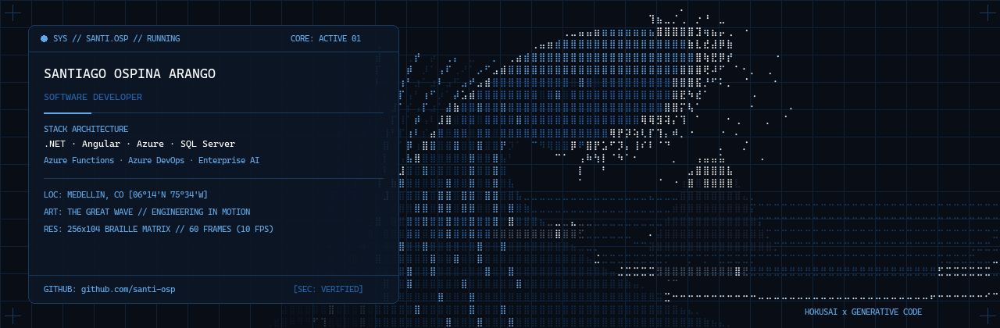

<div align="center">

<!-- The Great Wave Hero Banner: Dynamic Dark/Light Theme Switching -->
<picture>
  <source media="(prefers-color-scheme: dark)" srcset="assets/readme/wave-dark.gif">
  <source media="(prefers-color-scheme: light)" srcset="assets/readme/wave-light.gif">
  
</picture>

<br/>

### **Santiago Ospina Arango**
**Junior Software Developer | C# · .NET · Angular · Azure · SQL Server**  
*Building resilient full-stack systems, cloud integrations, and enterprise AI-driven automation.*

Medellín, Colombia &nbsp;·&nbsp; [LinkedIn](https://www.linkedin.com/in/santiago-ospina-arango-37bba0378) &nbsp;·&nbsp; [tuwebdebolsillo.com](https://tuwebdebolsillo.com) &nbsp;·&nbsp; [santiagoospinadev@gmail.com](mailto:santiagoospinadev@gmail.com)

<p align="center">
  
</p>

</div>

---

## 01 / ABOUT

I am a **Junior Software Developer** and Software Development Technology student at **Instituto Tecnológico Metropolitano (ITM)**, graduating in December 2026. 

I have practical enterprise experience designing, developing, and deploying full-stack architectures, cloud backends, database optimizations, and intelligent automation pipelines. My core stack centers on **C# / .NET**, **Angular**, **SQL Server**, and the **Microsoft Azure** ecosystem (**Azure Functions**, **Azure DevOps REST API**, **Azure Boards**, and **Azure Test Plans**).

In enterprise settings, I have engineered AI-assisted tools that automate user story generation, detect requirements ambiguities, and construct traceability matrices and test suites—directly shortening delivery cycles for multidisciplinary teams.

<details>
<summary><b>Resumen profesional en español (Clic para desplegar)</b></summary>
<br/>

Desarrollador de software junior y estudiante de Tecnología en Desarrollo de Software en el ITM (finalización prevista: dic. 2026), con experiencia empresarial construyendo soluciones full stack, integraciones y automatizaciones con C#/.NET, Angular, SQL Server, Azure Functions y Azure DevOps. He aplicado inteligencia artificial para optimizar la planeación, documentación de requerimientos, casos de prueba y optimización de bases de datos relacionales en entornos productivos.

</details>

<br/>

<div align="center">
  
</div>

---

## 02 / TECHNICAL EXPERTISE

My technical capabilities are structured around production reliability, clean code principles, and cloud-native workflows:

| Domain | Core Technologies & Methodologies |
|---|---|
| **Backend & APIs** | **C#**, **.NET 8 / 9 / 10**, ASP.NET Core, Entity Framework Core, RESTful APIs, Clean Architecture, Dependency Injection |
| **Frontend Engineering** | **Angular 19**, TypeScript, Reactive Forms, Component-Driven UI, JavaScript (ESNext), HTML5 / CSS3, Tailwind CSS, Astro, React |
| **Cloud & DevOps** | **Azure Functions**, Azure App Service, Azure DevOps, Azure Boards, Azure Test Plans, Azure DevOps REST API, CI/CD pipelines, Git / GitHub |
| **Data & Databases** | **SQL Server**, Stored Procedures, Execution Plan & Query Optimization, Relational Modeling, PostgreSQL (Neon) |
| **Enterprise AI & Automation** | Custom AI Agent Workflows, Prompt Engineering, Azure-n8n Integration Endpoints, Requirements Quality & Edge-Case Analyzers |
| **Testing & Quality Assurance** | Requirement-based Test Suites, Test Case Authoring, Traceability Matrices, xUnit, Playwright E2E |

<br/>

<div align="center">
  
</div>

---

## 03 / ENTERPRISE IMPACT & EXPERIENCE

### **Postobón S.A.** — *Practicante de Soluciones TI*
*Medellín, Colombia | Feb. 2026 – Aug. 2026*

- **End-to-End Enterprise AI Platform:** Architected and deployed a full-stack platform using **Angular 19**, **.NET Azure Functions**, and the **Azure DevOps REST API** to automatically generate, refine, and provision epics, features, user stories, and test suites with AI.  
  *Impact:* Adopted as a recurring operational tool by **40+ technical and functional users**.
- **Agile Backlog & QA Acceleration:** Integrated the tool directly with Service Desk, Azure Boards, and Azure Test Plans, linking work items to functional requirement suites.  
  *Impact:* **Reduced story documentation and QA preparation time by ~50%** for SAP implementation analysts.
- **Requirements Risk & Ambiguity Engine:** Engineered a rule and AI engine analyzing user stories prior to sprint commitment to flag ambiguities, technical dependencies, edge cases, and architectural risks.
- **High-Velocity Workflow Integration (n8n + Azure):** Developed high-throughput Azure endpoints connecting external n8n automation pipelines into Azure DevOps.  
  *Impact:* Enabled the generation and linking of **100+ structured work items in under 5 minutes**, reducing initial backlog planning time by **~70%**.
- **Database & Stored Procedure Optimization:** Diagnosed and tuned heavy SQL Server stored procedures and query execution plans supporting OMS and SDI business flows.  
  *Impact:* **Reduced query execution and data loading times by 40% – 50%**.
- **AI Talent Assessment Portal:** Developed a web application for a university Open Day that ingested and evaluated resumes with AI using Harvard and corporate evaluation criteria.
- **Service Desk Background Automation:** Implemented background scheduled tasks, SLA tracking routines, and automated alert workflows in .NET and SQL Server.

> **Confidentiality Notice:** In compliance with corporate non-disclosure agreements, enterprise source code, internal endpoints, and private corporate databases are strictly excluded from this profile. Public repositories demonstrate technical competencies through independent, open-source implementations.

<br/>

<div align="center">
  
</div>

---

## 04 / FEATURED PROJECTS

A selection of open-source architectures, full-stack systems, and engineering tools:

### [Codex Config Manager](https://github.com/santi-osp/codex-config-manager)
*Retro-pixel desktop control plane and telemetry monitor for OpenAI Codex and OmniRoute on Windows.*
- **Architecture:** Node.js server engine paired with lightweight local web interface, Windows VBS launchers, and granular TOML configuration engine.
- **Engineering Highlights:** Custom TOML parser with comment and whitespace preservation, multi-process lifecycle management, biometric security lock, bidirectional telemetry streaming, and automated E2E test suites with Playwright.
- **Stack:** JavaScript, Node.js, HTML5/CSS3, Playwright, Windows PowerShell.

---

### [DataGo — Residential CRM & Monorepo](https://github.com/santi-osp/PT)
*Clean Architecture backend and standalone Angular frontend managing residential customer lifecycles.*
- **Architecture:** Strict domain-driven separation (`DataGo.Domain`, `DataGo.Application`, `DataGo.Infrastructure`, `DataGo.Api`). Business logic remains decoupled from HTTP transport and persistence layers.
- **Engineering Highlights:** Version-controlled PostgreSQL stored procedures, EF Core 10, Npgsql routines, Angular 21 standalone components with Reactive Forms, and xUnit test suites.
- **Stack:** C# 14, .NET 10, EF Core, PostgreSQL (Neon), Angular 21, xUnit, Swagger / OpenAPI.

---

### [Web de Bolsillo](https://tuwebdebolsillo.com)
*Commercial digital platform engineered for high-performance responsive web presence.*
- **Architecture:** Static-first architecture deployed on Cloudflare Pages edge network, featuring technical SEO, JSON-LD structured data, and responsive layouts.
- **Engineering Highlights:** Achieved **98–100 Google Lighthouse mobile scores** and an initial **Largest Contentful Paint (LCP) of ~1.66s**.
- **Stack:** Astro, React, Tailwind CSS, Framer Motion, Cloudflare Pages.

---

### [DividirVideosNotebookLM](https://github.com/santi-osp/DividirVideosNotebookLM)
*In-browser client-side video processing utility designed for NotebookLM duration and payload constraints.*
- **Architecture:** 100% client-side execution utilizing WebAssembly-compiled FFmpeg.
- **Engineering Highlights:** Zero server uploads—processes high-definition video chunks directly inside the user's browser memory, guaranteeing total privacy and immediate chunk downloads.
- **Stack:** JavaScript, FFmpeg WebAssembly, Web Workers, HTML5 File API.

<br/>

<div align="center">
  
</div>

---

## 05 / GENERATIVE ART SYSTEM

The banner at the top of this profile is not a static stock graphic. It is generated by a custom Python procedural engine that interprets **Katsushika Hokusai's *The Great Wave off Kanagawa*** into **26,624 addressable Braille dot positions (`U+2800..U+28FF`)**.

```text
┌── GENERATIVE ENGINE SPECIFICATION ──────────────────────────────────────┐
│  GEOMETRY    : Cubic Bézier wave crest, curling lip & underside barrel  │
│  HARMONICS   : Continuous trigonometric phase breathing (T = 6.0s)      │
│  DYNAMICS    : 20 articulating foam claws + 95 ballistic spray droplets │
│  CONTINUITY  : Mathematically verified infinite loop (Δ = 0px jump)     │
│  CODEBASE    : scripts/banner/ (Python 3.14 · Pillow · NumPy)           │
└─────────────────────────────────────────────────────────────────────────┘
```

You can inspect the generator code, customize themes, or execute test suites directly from this repository:
- **Architecture & Design Decisions:** [`docs/DESIGN_DECISIONS.md`](docs/DESIGN_DECISIONS.md)
- **Technical Research & References:** [`docs/research/README_VISUAL_RESEARCH.md`](docs/research/README_VISUAL_RESEARCH.md)
- **Local Reproduction Guide (Windows 11):** [`docs/BANNER_GENERATION.md`](docs/BANNER_GENERATION.md)
- **Automated Test Suite:** [`tests/test_banner.py`](tests/test_banner.py)

```powershell
# Regenerate banners locally on Windows 11
python -m scripts.banner.generate
```

<br/>

<div align="center">
  
</div>

---

## 06 / CONTACT & COLLABORATION

I am open to junior software development positions, backend / full-stack engineering roles, and cloud automation projects:

<p align="center">
  <a href="https://www.linkedin.com/in/santiago-ospina-arango-37bba0378">
    
  </a>
  &nbsp;
  <a href="https://tuwebdebolsillo.com">
    
  </a>
  &nbsp;
  <a href="mailto:santiagoospinadev@gmail.com">
    
  </a>
</p>

<p align="center">
  <sub>© 2026 Santiago Ospina Arango · Crafted with Python, SVG, and Braille Generative Art.</sub>
</p>
